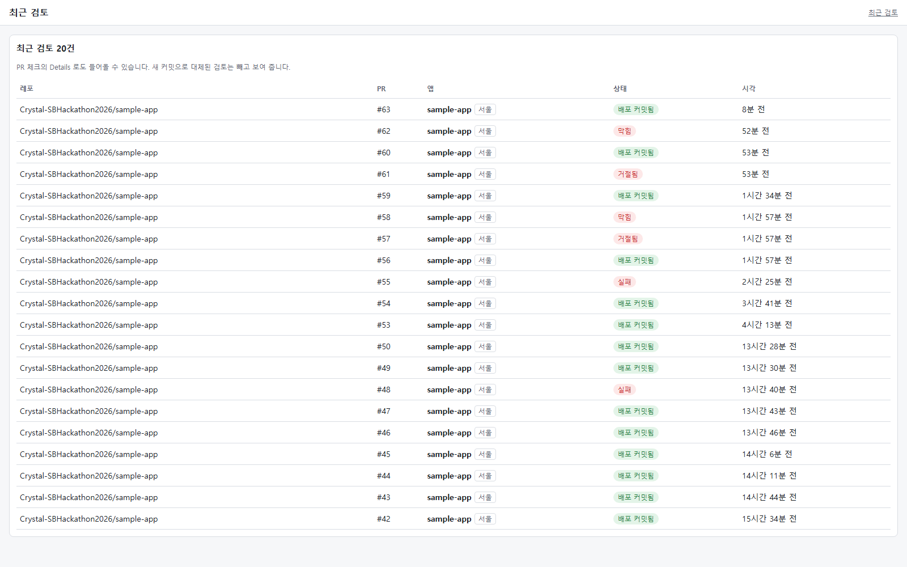
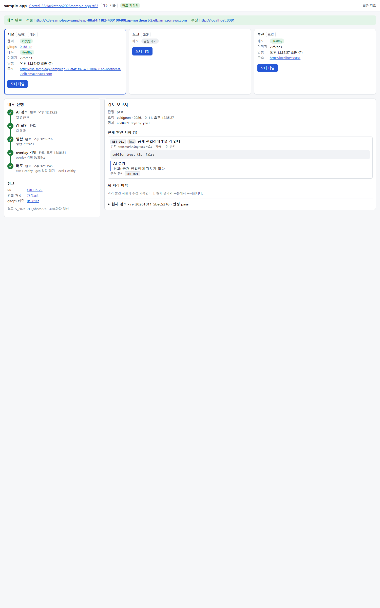
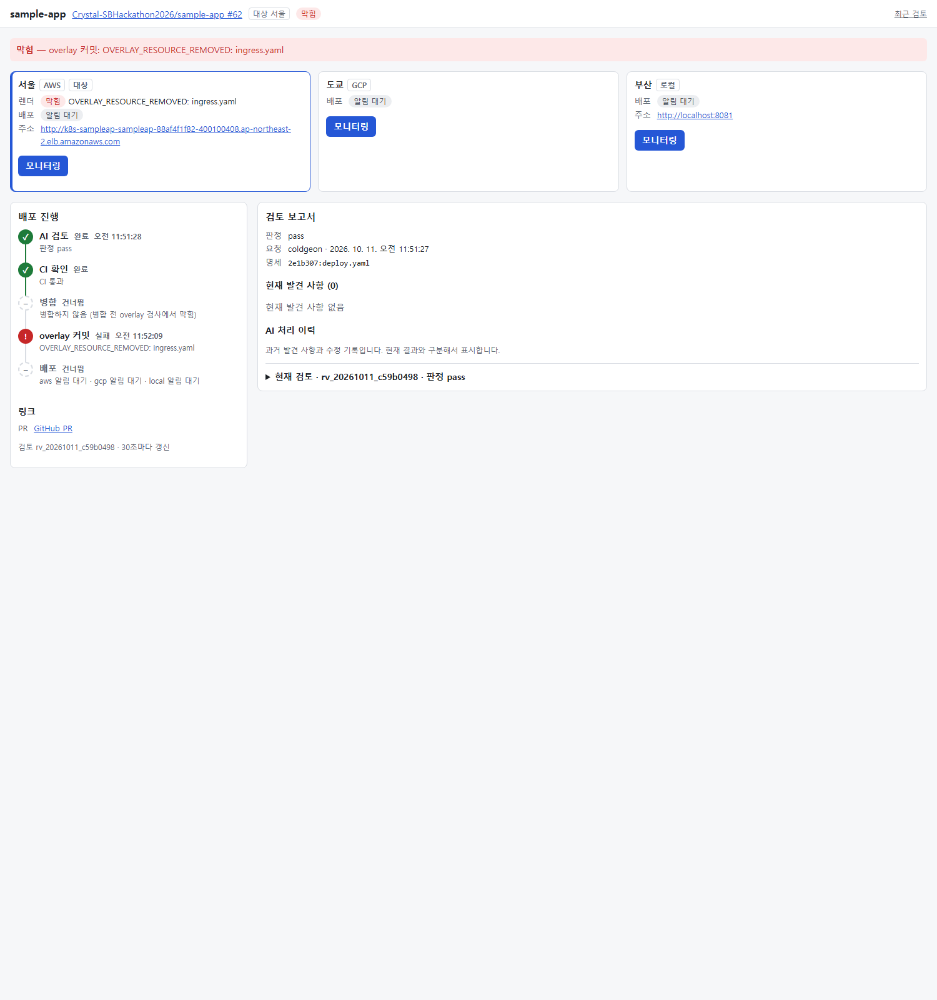
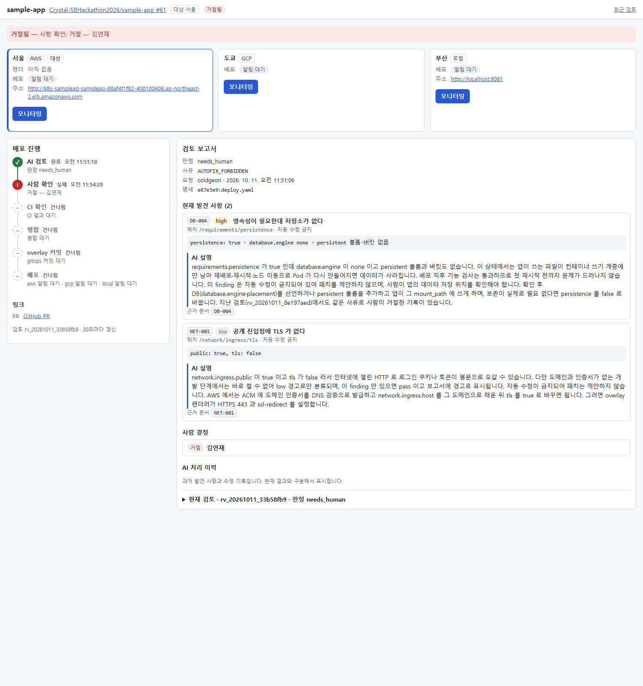
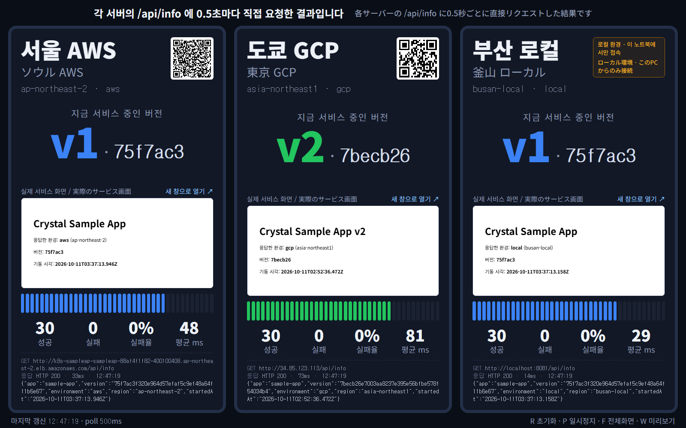
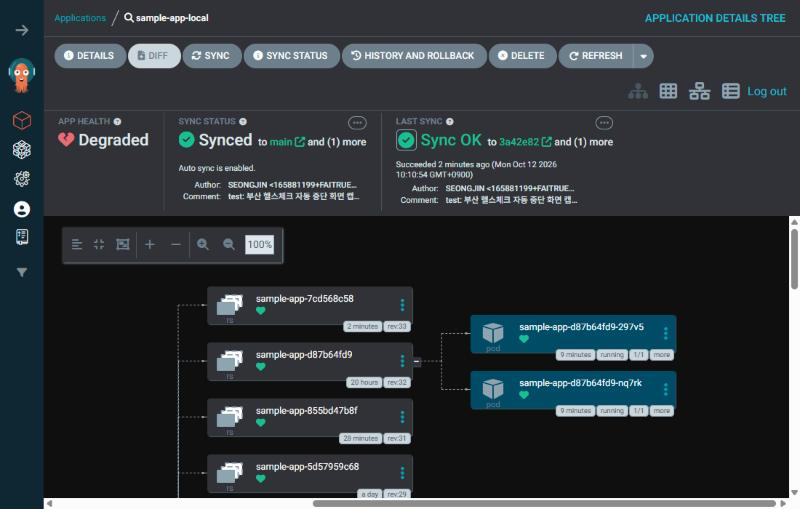

# 무엇을 시연할 수 있나

PR 하나를 올리면 AI가 검토하고, 통과한 것만 서울·도쿄·부산 세 환경에 각자 맞는 방식으로 배포됩니다.
**무엇을 넣으면 어떤 장면이 나오는지**를 실제 화면과 함께 정리했습니다.

아래 화면은 전부 **2026-10-11 리허설에서 실제로 찍은 것**입니다. 꾸민 그림이 아닙니다.

---

## 검토 결과는 네 갈래로 갈립니다



같은 앱에 올린 PR인데 결과가 다릅니다 — `배포 커밋됨` · `거절됨` · `막힘` · `실패`.
무엇을 넣었느냐에 따라 갈립니다.

| 넣는 것 | 규칙 | 나오는 것 | 걸린 시간 |
| --- | --- | --- | --- |
| 같은 이름을 `env` 와 `secrets` 양쪽에 | `SEC-004` | **AI가 직접 고쳐 커밋** → 재검토 통과 | 13초 |
| `requirements.persistence: true` | `DB-004` | **사람에게 넘김** → 승인 화면에서 결정 | 11초 |
| `network: {}` | `OVERLAY_RESOURCE_REMOVED` | AI는 통과시켰지만 **병합 직전 가드가 막음** | 32초 |
| 공개 진입점에 TLS 없음 | `NET-001` | **경고만** 하고 배포는 진행 | — |

---

## ① AI가 직접 고친다



같은 이름(`APP_NOTICE`)을 일반 환경변수와 비밀값 양쪽에 넣었습니다.
컨테이너에는 비밀값이 나중에 들어가 이기므로 **앞의 값은 쓰이지 않는데**, 명세와 git에는 남습니다.
예전 비밀이라면 평문으로 남는 셈입니다.

AI는 되돌릴 수 있는 문제라고 판단해 **`runtime.env` 쪽만 지우는 커밋**을 하고 다시 검토했습니다.

설명 끝에 이런 문장이 붙습니다.

> 지난 검토에서도 같은 방식으로 자동 수정되어 재검사를 통과했습니다.

**과거 사례를 근거로 인용합니다.** 배포 결과가 다음 검토의 근거가 되는 고리가 여기서 보입니다.

---

## ② AI가 통과시켜도 막힌다



**이 화면이 가장 중요합니다.**

```
판정        pass          ← AI 검토는 통과시켰다
병합        건너뜀         ← 병합하지 않음
overlay 커밋 실패          ← OVERLAY_RESOURCE_REMOVED: ingress.yaml
```

명세에서 외부 접속 설정을 통째로 지웠습니다. 문법은 멀쩡하고 규칙에도 안 걸립니다.
그런데 **병합 직전에 "실제로 만들어질 배포 결과"를 한 번 더 확인하는 가드**가, 지금 떠 있는 `ingress`가 사라지는 걸 보고 막았습니다.

이 규칙은 저희가 **개발 중에 실제로 겪은 장애**에서 나왔습니다.
2026-10-09, 명세가 없는 PR에서 자동 생성된 명세에 `ingress`가 빠졌고, 그대로 배포되어 로드밸런서까지 삭제됐습니다. 외부 접속이 10분간 끊겼습니다.

> AI를 믿되, 마지막은 코드가 봅니다.

---

## ③ AI가 사람에게 넘긴다



데이터를 저장하는 설정을 새로 켜는 변경입니다. 한 번 켜면 되돌리기 어렵습니다.
AI는 **자동으로 고치지 않고 이유만 설명한 뒤 결정을 사람에게 넘깁니다.**

승인 화면에서 사람이 승인하거나 거절합니다. 이 건은 거절했습니다.

> 판정은 코드가, 설명은 AI가, 결정은 사람이 합니다.

---

## 세 환경이 같은 커밋으로, 다른 방식으로



세 칸이 같은 저장소의 같은 커밋을 봅니다. 그런데 **배포 방식이 환경마다 다릅니다.**

| | 방식 | 무엇을 보고 판단하나 | 왜 |
| --- | --- | --- | --- |
| 서울 AWS | 카나리 | 앱 응답 **+ 에러율** | Prometheus가 있어 부분 실패까지 본다 |
| 부산 로컬 | 카나리 | 앱 응답 | 노트북 안 쿠버네티스 |
| 도쿄 GCP | **블루그린** | 사람이 승격 | DB가 걸려 있어 옛 버전과 섞이면 안 된다 |

위 화면은 **도쿄만 먼저 `v2`로 넘어간 순간**입니다. 사람이 승격을 누른 직후고, 서울·부산은 아직 `v1`입니다.

화면의 버전 문자열은 **이미지 태그 · 배포 설정 커밋 · 검토 기록의 키와 같은 값**입니다.
그래서 "지금 떠 있는 저것이 아까 그 PR이다"를 숫자 하나로 확인할 수 있습니다.

---

## 배포한 뒤에 드러나는 문제도 잡습니다

앱에 스위치를 두 개 두고 일부러 고장을 냅니다. **안전장치가 작동하는 걸 말이 아니라 실제로 보여주기 위해서입니다.**

### 일부 요청만 실패할 때 — 에러율이 잡는다

```
FAIL_RATE: "0.3"      요청의 30% 를 실패시킨다
```

앱은 응답하므로 **단순 헬스체크는 통과합니다.** 그런데 에러율이 기준 5%를 두 번 넘기자 배포가 스스로 멈추고 이전 버전으로 돌아갔습니다. 그동안 서비스는 끊기지 않았습니다.

```
RolloutAborted: Metric "error-rate" assessed Failed
                due to failed (2) > failureLimit (1)
```

> 🔴 **이건 트래픽이 있어야만 작동합니다.** 요청이 없으면 비율을 계산할 분모가 없어 그냥 통과합니다.
> 저희가 실제로 당했고(10/10), 그래서 분석이 도는 동안 요청을 계속 보내는 부하 장치를 따로 두었습니다.

### 아예 뜨지 못할 때 — 헬스체크가 잡는다

```
HEALTH_FAIL: "true"   /healthz 가 실패한다
```

60초 안에 준비되지 못하면 중단합니다. **에러율 분석과 별개로 도는 바깥쪽 안전장치**입니다.

대회가 끝난 뒤(2026-10-12) 부산 클러스터에서 다시 재현해 화면을 남겼습니다.



새 버전(`rev:33`)의 상자에 **파드가 하나도 달려 있지 않습니다.** 오른쪽에 붙어 있는 두 개는 전부 **이전 버전**이고 둘 다 `running 1/1` 입니다. 새 버전은 한 번도 뜨지 못했고, 그 사이 서비스는 옛 버전이 계속 했습니다.

```
01:10:53   새 파드 생성
01:11:08   0/1 — 준비되지 않는다
01:11:55   앱 상태 Degraded
01:12:01   배포 중단

RolloutAborted: Rollout aborted update to revision 33:
  ReplicaSet "sample-app-7cd568c58" has timed out progressing.
```

#### 그동안 사용자는 실패를 한 건도 보지 않았습니다

중단되는 내내 1초마다 앱을 호출해 기록했습니다.

```
측정 63회 (01:11:02 ~ 01:12:48)

  200          63건   (100%)
  옛 버전       63건   (100%)
```

배포 시스템의 상태 역시 둘을 나눠서 말합니다.

```
Available = True     쓸 수 있다
Healthy   = False    건강하지는 않다
```

**「건강하지 않다」와 「쓸 수 없다」는 다릅니다.** 자동 중단은 되돌리는 것이 아니라 **멈추는 것**이고, 멈춰 있는 동안 이전 버전이 그대로 서비스합니다. 카나리를 쓰는 이유가 이것입니다.

### 🔴 그런데 부산에서는 이 안전장치가 약합니다 — 끝나고 알았습니다

위 「에러율이 잡는다」는 **서울 이야기입니다.** 부산·도쿄에는 지표 수집기(Prometheus)가 없어 **응답 검사 하나로** 버팁니다.

2026-10-12 에 부산에서 일부러 **100% 실패하는 버전**을 올려봤습니다. **멈추지 않고 그대로 배포됐습니다.**

```
분석 결과   측정 6회 전부 통과
실제 상태   /api 요청이 100% 실패하는 중
```

원인은 검사식이 틀려서가 아니라 **표본이 빗나가서**입니다. 응답 검사는 공용 입구로 찍으므로 새 버전에 맞을지 옛 버전에 맞을지가 운입니다.

```
새 버전 1 대  +  옛 버전 2 대       →  새 버전에 맞을 확률 1/3
6번 찍어 2번 이상 맞아야 중단        →  놓칠 확률 약 35%
```

서울은 지표에 **버전 꼬리표**가 붙어 있어 새 버전만 따로 셉니다. 운이 끼어들 자리가 없습니다.

```
서울   새 버전만 측정      확실하게 잡는다
부산   입구에서 6번 찍기   세 번에 한 번은 놓친다
도쿄   분석 없음           해당 없음
```

헬스체크(위)는 세 환경 모두 확실합니다 — 뜨지 못한 파드는 애초에 입구에 들어오지 못하니까요. **구멍은 「떠 있지만 틀린 답을 주는」 경우에만 생깁니다.**

적어 두는 이유는, 이게 저희가 이미 열어 둔 [과제](https://github.com/Crystal-SBHackathon2026/gitops/issues/74)와 **같은 종류의 문제**이기 때문입니다. 둘 다 "판정이 눈을 감는 구간"이고, 고치는 방향도 같습니다 — **운에 기대지 않고, 충분한 표본이 모였을 때만 판정하는 것.**

---

## 발표에서는 안 썼지만 보여줄 수 있는 것

위까지가 최종 발표에서 실제로 보여준 흐름입니다. 아래는 **만들어 두었지만 5분 안에 넣지 못한 것들**입니다.

### 명세가 없거나 깨졌을 때

| 넣는 것 | 나오는 것 |
| --- | --- |
| `deploy.yaml` 을 아예 지운 PR | 레포를 분석해 **명세를 자동 생성**한다 |
| YAML 문법을 깨뜨린 `deploy.yaml` | AI가 **형식만 복구**하고, 원래 값이 바뀌지 않았는지 코드로 대조한다 |

🔴 자동 생성에는 사고 이력이 있습니다. 2026-10-09에 이전 배포 기록 없이 명세를 만들다 `ingress` 를 빠뜨렸고, 그대로 배포되어 외부 접속이 10분간 끊겼습니다.
그래서 지금은 **이전 배포 기록 없이 생성된 명세는 `pass` 여도 사람에게 넘깁니다.** 위의 「가드가 막는다」 규칙도 같은 사고에서 나왔습니다.

### 리소스 상한이 빠졌을 때

부산(로컬) 환경에서는 CPU·메모리 상한이 없는 명세를 **AI가 채워서 커밋**합니다. 한 앱이 노트북 자원을 다 쓰는 걸 막기 위해서입니다.
환경에 따라 같은 항목의 심각도가 다릅니다 — 클라우드에서는 경고지만 로컬에서는 고칩니다.

### 보호장치 안의 눈먼 구간 — 실제로 당한 사례

위 에러율 경고에 적은 그 일입니다. 2026-10-10, 30% 실패 버전이 자동 중단 없이 그대로 승격됐습니다.

```
요청 없음    측정 [0] [0] [0] [0]   → 통과 → 30% 실패가 100% 로 퍼짐
요청 있음    측정 [0.24] …          → 2번째 초과에서 자동 중단
```

같은 설정, 같은 장애인데 **트래픽 유무만으로 결과가 갈렸습니다.** 비율을 계산할 분모가 없으면 0으로 읽히기 때문입니다.
그래서 분석이 도는 동안 요청을 계속 보내는 장치를 따로 두었습니다. **보호장치 안에 눈먼 구간이 있었다**는 사례 자체가 보여줄 만합니다.

### 환경마다 다른 판단

같은 명세를 서울·부산·도쿄에 각각 넣으면 **환경별로 다른 결과**가 나옵니다. 능력표(Prometheus 유무, 스토리지 종류, 노드 수)가 달라서입니다.
예를 들어 같은 볼륨 설정이 AWS에서는 통과하고 로컬에서는 경고가 붙습니다.

---

## 구조 자체를 보여주는 것

PR을 올리지 않고도 화면으로 바로 확인할 수 있는 것들입니다.

| 질문 | 보여주는 법 |
| --- | --- |
| 검토 없이 병합하면? | PR Checks의 `review-service/verify`가 필수 체크라 **병합 버튼이 안 눌린다** |
| AI가 서버를 직접 만지나? | git에만 커밋한다. 클러스터를 손으로 고쳐도 **Argo CD가 git 상태로 되돌린다** |
| 사내망에 구멍을 뚫나? | 부산은 노트북 안의 Argo CD가 **밖으로 나가 가져온다.** 중앙 화면에 부산이 안 보이는 것이 증거 |
| 같은 커밋인 걸 어떻게 믿나? | 세 칸의 버전 문자열이 글자까지 같다 |

---

## 걸리는 시간

**PR을 올리고 세 환경에 배포될 때까지 1분 47초입니다.** (2026-10-11 실측, 사람이 승인하는 시간 제외)

```
10:46:23   PR 올림                                   (GitHub 기록)
10:46:40   AI 검토 완료 · 자동 수정 1회 포함             17초
10:47:18   자동 병합                                   38초
10:47:24   배포 설정 커밋                                6초
10:48:10   세 환경 배포 완료                             46초
```

처음에는 6분 17초였습니다. 구간별로 재서 하나씩 줄였습니다.

| | 전 구간 | 무엇을 고쳤나 |
| --- | --- | --- |
| 처음 | 6분 17초 | |
| | 3분 57초 | 배포 도구가 새 커밋을 3분간 못 보던 리비전 캐시 |
| | 2분 53초 | 테스트·빌드 병렬화, 배포 설정 갱신을 별도 단계에서 빌드 안으로 |
| | 2분 31초 | PR·main 중복 빌드 제거, 재조회 주기·캐시 단축 |
| | 2분 14초 | 카나리 분석 창 60초 → 30초 (지표 수집 주기도 같이 5초로) |

> 🔴 **캐시는 오히려 느렸습니다.** 빌드 캐시를 넣으면 42초 빨라질 거라 예상했는데 실제로는 **20초 느려졌습니다.** 실제 빌드가 5초인데 캐시를 주고받는 데 33초가 붙었고, 의존성이 두 개뿐이라 아낄 층이 없었습니다. 되돌렸습니다.

### 2분 14초와 1분 47초는 조건이 다릅니다

마지막 두 숫자는 **그대로 비교하면 안 됩니다.**

| | 측정 | 범위 | 명세 변경 |
| --- | --- | --- | --- |
| 2분 14초 | 10/10 · `sample-app#37` | **서울 한 곳** | 없음 (README 한 줄) → 검토 거의 즉시 |
| 1분 47초 | 10/11 · `sample-app#56` | **세 환경 동시** | 있음 + AI 자동 수정 1회 → 검토 17초 |

**검토는 더 오래 걸렸는데 전체는 더 빨랐습니다.** CI나 배포 구간이 줄었다는 뜻인데, `#56` 쪽은 구간별 기록이 남지 않아 **어디서 줄었는지는 특정하지 못했습니다.** 그 사이 의도적으로 바꾼 설정은 없으므로, 러너 대기나 네트워크 같은 변동일 수 있습니다.

확실한 것은 **두 경우 모두 2분 안에 끝났다**는 것입니다. 바닥은 GitHub이 작업을 집어가기까지의 대기와, 카나리가 "절반만 먼저 보내고 지켜보는" 시간입니다. 뒤쪽은 줄이면 안 되는 시간입니다.

## 아직 못 하는 것

정직하게 적습니다.

| | |
| --- | --- |
| DB 자동 생성 | 데이터베이스가 필요한 앱은 명세는 만들어지지만 실제 생성까지 못 간다 |
| 느린 장애 | 카나리는 30초만 본다. 메모리 누수처럼 천천히 나빠지는 건 못 잡는다 |
| 에러율 기준 5% | 실측 근거 없이 데모용으로 정한 값이다 |
| 부산 지표 | Prometheus가 서울에만 있어, 부산 그래프는 아직 비어 있다 |
| 부산·도쿄의 판정 | 지표가 없어 응답 검사 하나로 버틴다. 떠 있지만 틀린 답을 주는 버전을 **세 번에 한 번 놓친다** (위 참고) |

## 데모 뒤 — 지금 저장소를 보시는 분께

대회가 끝나고 **클라우드 자원을 정리했습니다.** 서울(AWS)과 도쿄(GCP)의 공개 주소는 더 이상 응답하지 않고, 부산은 발표자 노트북 안에 있던 클러스터입니다. 위 화면들은 2026-10-11 당시에 실제로 찍은 것이고, 지금 링크를 눌러 다시 볼 수는 없습니다.

`sample-app` 의 `deploy.yaml` 에는 **데모용 설정이 그대로 남아 있습니다** — 요청의 30%를 일부러 실패시키는 `FAIL_RATE: '0.3'` 입니다. 되돌리지 않은 것이 아니라, **되돌릴 수 없습니다.**

되돌리려면 PR 을 올려야 하고, 그 PR 이 병합되려면 필수 체크 세 개를 통과해야 합니다.

```
test                      GitHub Actions 가 낸다      ✅ 지금도 된다
build                     GitHub Actions 가 낸다      ✅ 지금도 된다
review-service/verify     AI 검토 서비스가 낸다        ❌ 서비스를 내려서 낼 사람이 없다
```

세 번째를 낼 주체가 사라졌으므로 **지금 이 저장소의 `main` 에는 아무도, 관리자도 커밋을 넣을 수 없습니다.**

의도한 결과는 아니지만, 이게 **「AI 검토를 통과하지 않은 코드는 배포되지 않는다」가 설정값 한 줄이 아니라 실제로 작동하는 잠금이었다는 증거**입니다. 서비스가 꺼지면 파이프라인도 같이 멈춥니다. 열려 있는 우회로가 없습니다.
